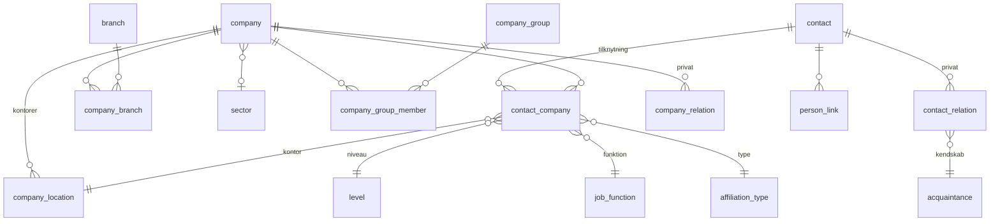

# Datamodel

Mål: delt lag for fakta om personer og virksomheder, privat lag for hver brugers viden. Alle tabeller har RLS. Delte tabeller kræver `private.is_member()`. Private tabeller kræver `owner_id = (select auth.uid())`.

## Delt lag
| Tabel | Indhold |
|---|---|
| `app_user` | Brugere med adgang, rolle (owner, member) |
| `contact` | Navn, e-mail, telefon, LinkedIn (normaliseret, unik), status, created_by |
| `company` | Navn, CVR (unik), website, sektor, status, created_by |
| `company_location` | Navn, hovedkontor-flag, adresse, postnummer, by, land, lat/lng, aktiv |
| `contact_company` | Tilknytning: type, niveau, funktion, kontor, primær, fra/til |
| `company_branch` | Brancher pr. virksomhed, én primær |
| `company_group`, `company_group_member` | Grupper, rolle pr. medlem |
| `audit_log` | Hvem ændrede hvad og hvornår |
| Opslag | `level`, `job_function`, `acquaintance`, `affiliation_type`, `branch` (træ), `sector`, `group_role`, `postcode` (med region og kommune) |

Alle opslag: code, name, sort_order, active, is_system. Alle kan læses af medlemmer og udvides af ejer.

## Privat lag
| Tabel | Indhold |
|---|---|
| `contact_relation` | Noter, kendt siden, kendskab, ingen invitation |
| `person_link` | Person til person: kollega, tidligere kollega, rapporterer til, samarbejdspartner, mentor |
| `company_relation` | Modenhed (stage), override, ansvarlig, noter |
| `company_typology` | Typologi-scores |
| `company_typology` | Typologi-scores (senere) |
| `intel`, `followup`, `label` | Viden, opfølgning, labels (fase 3) |
| `activity` (+ links) | Møder, opkald, mails (fase 3) |
| `attachment` | Filer i privat Storage-bucket (fase 3) |
| `project`, `framework`, `role` | Projekter, rammeaftaler, roller (fase 4) |

## Regler der skal håndhæves i databasen
- Partielt unikt indeks: én primær aktuel tilknytning pr. person.
- Partielt unikt indeks: ét hovedkontor pr. virksomhed.
- Sammensat fremmednøgle `(location_id, company_id)` på `contact_company`, så kontoret tilhører samme virksomhed.
- Unikt indeks på normaliseret LinkedIn-URL og på CVR.
- Højst ét moderselskab pr. gruppe.
- Private rækker må kun pege på delte rækker, aldrig på andre brugeres private rækker. Tjek på begge sider af hver reference, fordi fremmednøgler omgår RLS.
- Trigger opretter `app_user` ved invitation. Ingen selvtilmelding.
- Views er `security_invoker`.
- `private.is_member()` ligger i schema `private`, så den ikke kan kaldes via REST.

## Aktiviteter
- `activity_type` (opslagsliste), `activity` (type, dato, titel, tekst, kilde-link, synlighed shared/private).
- `activity_participant` (aktivitet, person, virksomhed personen repræsenterede), `activity_subject` (aktivitet, person), `activity_company` (aktivitet, virksomhed), `activity_file` (sti i lagerbøtten `activity-files`, filnavn, størrelse).
- RLS: delt lag for medlemmer. Privat aktivitet kun for skaberen. Børnetabeller og filer følger aktivitetens synlighed.
